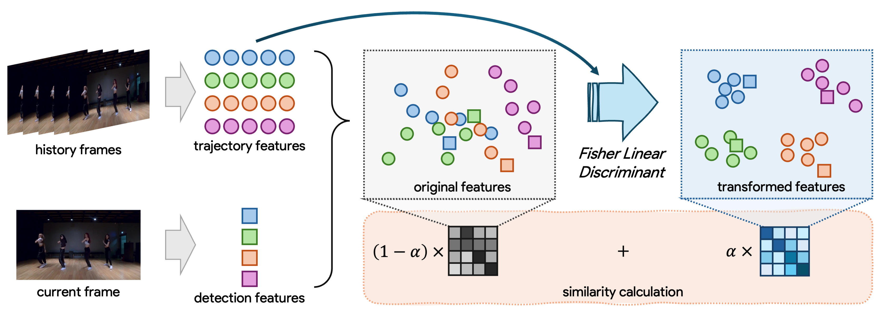

# 🎩 History-Aware Transformation of ReID Features for Multiple Object Tracking

This is the official PyTorch implementation of our paper:

> ***[History-Aware Transformation of ReID Features for Multiple Object Tracking](https://arxiv.org/abs/2503.12562)*** <br>
> :mortar_board: [Ruopeng Gao](https://ruopenggao.com/), [Yuyao Wang](https://scholar.google.com.hk/citations?hl=zh-CN&user=qti6IlwAAAAJ), [Chunxu Liu](https://lcxrocks.github.io/), [Limin Wang](https://wanglimin.github.io/) <br>
> :e-mail: Primary contact: ruopenggao@gmail.com

## :mag: Overview

**TL; DR.** We propose a plug-and-play **H**istory-**A**ware **T**ransformation algorithm for appearance features (*i.e.*, ReID features). **Guided by historical information, we seek a more discriminative subspace for target features** in video sequences, enabling **better differentiation between different trajectories**. Our method significantly enhances the reliability of appearance features, improving the performance of ReID-based MOT trackers.




## :fire: News

- <span stype="font-variant-numeric: tabular-nums;">**2026.07.22**</span>: The latest version of our paper is now available on arXiv. It includes ***a more systematic analysis of the relationship between similarity measures and tracking performance, revealing long-standing issues in the ReID space and explaining how our method improves its representations***. :fire:
- <span stype="font-variant-numeric: tabular-nums;">**2026.07.18**</span>: The updated version of the paper will be posted on arXiv soon, with a ***more comprehensive analysis***. :soon:
- <span style="font-variant-numeric: tabular-nums;">**2026.06.18**</span>: Our paper is accepted by ***ECCV 2026*** ~ :tada: :tada:


## :open_file_folder: Sub-Projects

Theoretically, our proposed method can be applied to any multiple object tracker equipped with a ReID or appearance branch. Since different methods are often built on varying codebases, our repository is organized into separate sub-projects to ensure compatibility with different frameworks. Each sub-project should be treated and run independently.

Currently, we provide the following sub-project implementations:

- [HAT-MASA](./HAT-MASA/): [MASA](https://github.com/siyuanliii/masa) is a tracking model based purely on appearance feature matching, which has achieved remarkable performance in zero-shot tracking.
- [HAT-SORT](./HAT-SORT/): Since nearly all heuristic Multiple Object Tracking (MOT) algorithms adhere to the SORT-like design paradigm, we have selected a set of the most popular codebases as our foundation for implementation and modification.


## :pencil2: Citation

If you think this project is helpful, please feel free to leave a :star: and cite our paper:

```tex
@article{{HATReID-MOT},
  title={History-aware transformation of reid features for multiple object tracking},
  author={Gao, Ruopeng and Wang, Yuyao and Liu, Chunxu and Wang, Limin},
  journal={arXiv preprint arXiv:2503.12562},
  year={2025}
}
```
